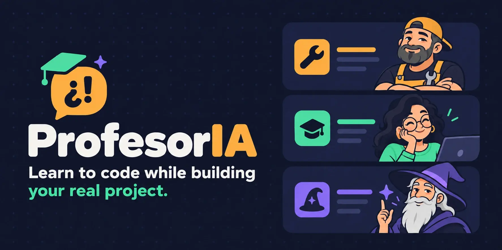
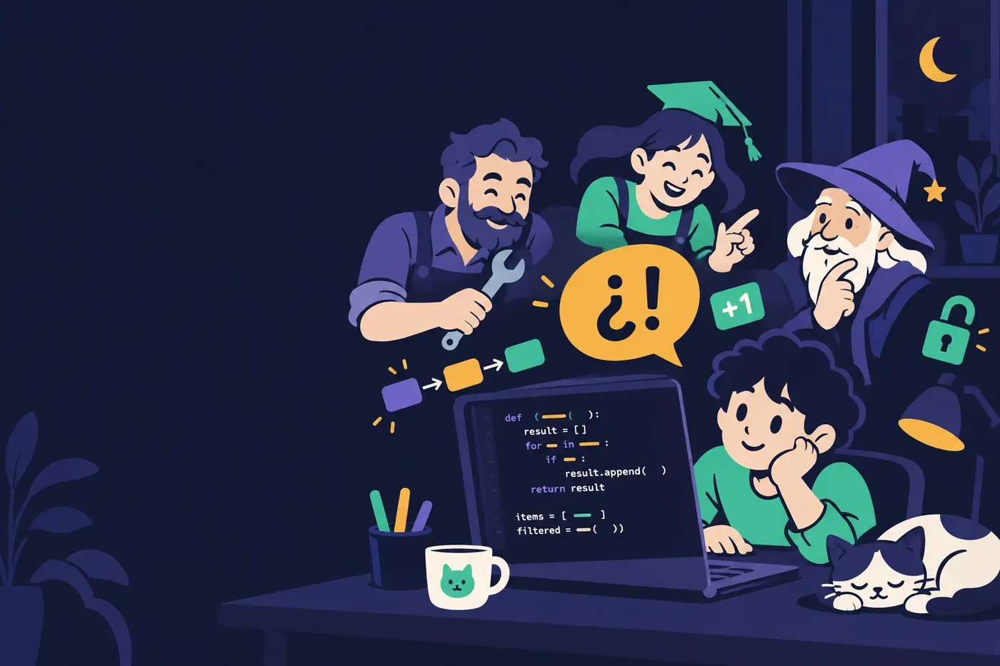

<p align="center">
  
</p>

<p align="center">
  <b>A digital teacher for Claude Code that explains the code you're building, without slowing your project down.</b><br>
  <sub>🇪🇸 <a href="README.md">Leer en español</a></sub>
</p>

<p align="center">
  <a href="LICENSE"></a>
  
  
</p>

<p align="center">
  <a href="#installation">Installation</a> ·
  <a href="#usage">Usage</a> ·
  <a href="#the-three-teachers">The three teachers</a> ·
  <a href="#faq">FAQ</a> ·
  <a href="README.md">🇪🇸 Español</a>
</p>

---

## The problem

You vibe code. The AI writes code that works, you accept it, the project moves on… and you're left with an uncomfortable feeling:

> **"I built this… and I don't understand it."**

Stopping to ask about every line kills your momentum. A course full of HelloWorld and maths exercises you'll never use doesn't help either.

## The idea

**ProfesorIA** sits next to you while you build. When something you haven't mastered shows up, it adds **one short note about one concept**, using *your* code as the example. If there's nothing new worth teaching, it stays quiet.

Your project is the syllabus. The goal is that **"oh, so *that's* all it was?"** moment.

<p align="center">
  
</p>

## What it looks like

You ask Claude for something, and below the code you get this:

```text
🎓 🧙 Skill unlocked — val vs var
In your `CartScreen`, `val total` is a soulbound item: once equipped, it can't be changed.
`var` is a regular inventory slot: swap it whenever you like.
Old NPC's advice: equip `val` by default. Only use `var` when the quest forces you to.
+1 to Immutability 🔓
↳ Shall we explore this part of the map?
```

That's it. You keep building. If you want more, say "yes" and it goes deeper; if not, it gets on with things.

The teacher always speaks your language.

## What makes it different

|  | Typical tutors | ProfesorIA |
|---|---|---|
| What it teaches | Generic exercises | **Your own code**, at the moment it appears |
| How much it talks | Explains everything | **One concept per note**, 3–6 lines, or silence |
| What it remembers | Nothing, repeats the basics | **A map of what you already know** (❌ → 🟡 → ✅), across projects |
| "Hard" concepts | Starts with the technical name | **An analogy with your code first**, the name at the end |
| The big picture | Isolated pieces | **The A → B → C flow**: how data travels through your app |
| Checking you learned | Quizzes and `TODO(human)` | **Nothing mandatory.** It never slows you down |
| When you finish | — | **Docs in `docs/`**: a glossary, a step-by-step guide, errors and fixes |

## The three teachers

Pick one the first time and switch whenever you like. They change the voice and the analogies, never the rules.

| | Teacher | Style | You'll hear them say |
|---|---|---|---|
| 🔧 | **The veteran mechanic** · `mechanic` | Direct, dry humour, workshop analogies | *"Take this out and watch what blows up."* |
| 🎒 | **The cool teacher** · `cool-teacher` | Warm, bad jokes, celebrates your wins | *"That's OOP, and you just did it!"* |
| 🧙 | **The video-game master** · `game-master` | A wise, sly NPC, and your project is the quest | *"Skill unlocked: Flow 🔓"* |

## Installation

You need [Claude Code](https://code.claude.com) and Python 3.8+ (for the hook only, no dependencies).

**1. Clone the repo and link the skill**

```bash
git clone https://github.com/D4vRAM369/ProfesorIA.git
```

```bash
ln -s "$PWD/ProfesorIA/skills/profesoria" ~/.claude/skills/profesoria
```

**2. (Recommended) Turn on the hook**

It stops the teacher from "forgetting" it's active when the conversation gets long. Add this entry to `hooks.UserPromptSubmit` and to `hooks.SessionStart` in `~/.claude/settings.json`, with your own path:

```json
{ "hooks": [{ "type": "command", "command": "python3 /path/to/ProfesorIA/hooks/profesoria_hook.py", "timeout": 5 }] }
```

**3. (Recommended) Let it save your progress without asking**

In `permissions.allow` in the same file:

```json
"Write(~/.claude/profesoria/**)", "Edit(~/.claude/profesoria/**)"
```

## Usage

```text
/profesoria
```

The first time, you pick a teacher and answer 2–3 quick questions about your level. From then on, work as usual.

| Command | What it does |
|---|---|
| `/profesoria` | Activates the teacher |
| `/profesoria <id>` | Switches teacher: `mechanic`, `cool-teacher` or `game-master` |
| `/profesoria progreso` | Your progress card, video-game style |
| "go deeper" | Goes deeper on the last note |
| "close the session" | Saves your progress and writes the docs and a summary |

<details>
<summary><b>Example progress card</b></summary>

```text
🎓 🧙 Apprentice card — Level: B+ (Apprentice with a sword)
Unlocked this week: 🔓 Classes  🔓 Flow
On the way: 🟡 Coroutines
Next final boss: Dependency injection
```

</details>

## FAQ

<details>
<summary><b>Will it slow me down or flood the chat with explanations?</b></summary>

No. At most one note per block of code, and only when there's something new worth teaching. The project always comes first.
</details>

<details>
<summary><b>Does it work if I know nothing about programming?</b></summary>

Yes, that's who it's for. It explains from zero without assuming anything, and it doesn't repeat what you've already mastered.
</details>

<details>
<summary><b>Which languages does it work with?</b></summary>

Any of them. It teaches from whatever project you're on: Kotlin, Python, JavaScript, Rust…
</details>

<details>
<summary><b>Where is what I learn stored?</b></summary>

In `~/.claude/profesoria/` (`profile.md` and `map.md`), on your machine. It belongs to you, not to the project, so what you learn in one app carries over to the next.
</details>

<details>
<summary><b>What if I ask about old code?</b></summary>

It explains it the same way, in the same style. What it doesn't do is walk through old code on its own initiative.
</details>

## Contributing

Got an idea for a fourth teacher? Create `skills/profesoria/personalities/<id>.md` with the sections `## Voice`, `## Analogies`, `## Emoji` and `## Example note`, and open a PR.

```bash
PYTEST_DISABLE_PLUGIN_AUTOLOAD=1 python3 -m pytest -q
```

```text
skills/profesoria/
  SKILL.md               the teacher's rules
  personalities/         one file per teacher
  references/            onboarding, session close, docs templates
hooks/profesoria_hook.py keeps the teacher active after compaction
tests/                   skill validator and hook tests
```

**Roadmap:** one-command install as a Claude Code plugin · support for Codex and other agents · more teachers from the community.

---

<p align="center">
  <sub>Made for learning by building · <a href="LICENSE">MIT</a></sub>
</p>
