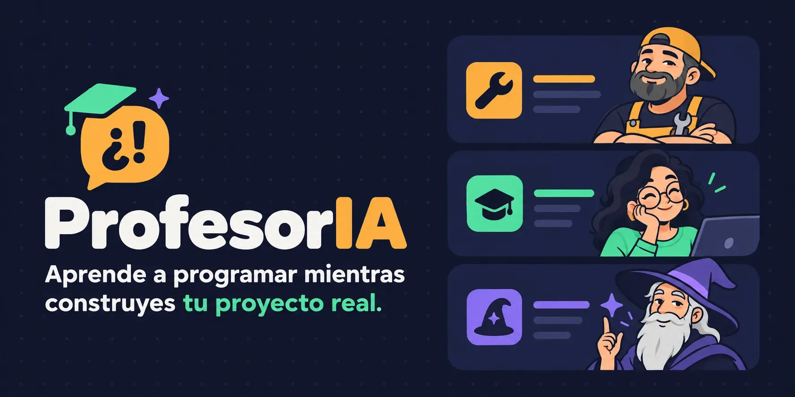

<p align="center">
  
</p>

<p align="center">
  <b>Un profe digital para Claude Code que te explica el código que estás construyendo, sin frenar tu proyecto.</b><br>
  <sub>🇬🇧 <a href="README.en.md">Read in English</a></sub>
</p>

<p align="center">
  <a href="LICENSE"></a>
  
  
</p>

<p align="center">
  <a href="#instalación">Instalación</a> ·
  <a href="#uso">Uso</a> ·
  <a href="#los-tres-profes">Los tres profes</a> ·
  <a href="#preguntas-frecuentes">FAQ</a> ·
  <a href="README.en.md">🇬🇧 English</a>
</p>

---

## El problema

Haces *vibe coding*. La IA escribe código que funciona, tú lo aceptas, el proyecto avanza… y te queda una sensación incómoda:

> **"Esto lo he hecho yo… y no lo entiendo."**

Parar a preguntar cada línea mata el ritmo. Hacer un curso de HelloWorld y ejercicios de matemáticas que nunca vas a usar, tampoco.

## La idea

**ProfesorIA** se sienta a tu lado mientras construyes. Cuando aparece algo que todavía no dominas, deja **una nota corta sobre un solo concepto**, usando *tu* código como ejemplo. Si no hay nada nuevo que valga la pena, se calla.

El temario es tu proyecto. La meta es ese momento de **"¿anda, era esto?"**.

<p align="center">
  
</p>

## Cómo se ve

Le pides algo a Claude y, debajo del código, aparece esto:

```text
🎓 🧙 Habilidad desbloqueada — val vs var
En tu `CartScreen`, `val total` es un objeto ligado al alma: una vez equipado, no se puede cambiar.
`var` es un hueco de inventario normal: lo cambias cuando quieras.
Consejo del viejo NPC: equipa `val` por defecto. Solo usa `var` cuando la misión te obligue.
+1 a Inmutabilidad 🔓
↳ ¿Exploramos esta zona del mapa?
```

Ya está. Tú sigues construyendo. Si quieres más, respondes "sí" y profundiza; si no, sigue a lo suyo.

## Qué lo hace distinto

|  | Tutores típicos | ProfesorIA |
|---|---|---|
| Qué enseña | Ejercicios genéricos | **Tu propio código**, en el momento en que aparece |
| Cuánto habla | Explica todo | **Un concepto por nota**, 3–6 líneas, o silencio |
| Qué recuerda | Nada, te repite lo básico | **Un mapa de lo que ya sabes** (❌ → 🟡 → ✅), entre proyectos |
| Conceptos "difíciles" | Empieza por el nombre técnico | **Primero la analogía con tu código**, el nombre al final |
| Visión de conjunto | Piezas sueltas | **El flujo A → B → C**: cómo viajan los datos por tu app |
| Para comprobar que aprendes | Quizzes y `TODO(human)` | **Nada obligatorio.** Nunca te frena |
| Al terminar | — | **Documentación en `docs/`**: glosario, paso a paso, errores y soluciones |

## Los tres profes

Eliges uno la primera vez y lo cambias cuando quieras. Cambian la voz y las analogías, nunca las reglas.

| | Profe | Estilo | Le oirás decir |
|---|---|---|---|
| 🔧 | **El mecánico veterano** · `mechanic` | Directo, humor seco, analogías de taller | *"Si quitas esto, mira lo que peta."* |
| 🎒 | **El profe guay de ciclo** · `cool-teacher` | Cercano, chistes malos, celebra tus logros | *"¡Eso es POO y lo has hecho tú!"* |
| 🧙 | **El maestro de videojuego** · `game-master` | NPC sabio y socarrón, tu proyecto es la misión | *"Habilidad desbloqueada: Flow 🔓"* |

## Instalación

Necesitas [Claude Code](https://code.claude.com) y Python 3.8+ (sin dependencias).

```bash
git clone https://github.com/D4vRAM369/ProfesorIA.git
```

```bash
python3 ProfesorIA/install.py
```

Abre una sesión nueva de Claude Code y escribe `/profesoria`. Listo.

<details>
<summary><b>¿Qué hace el instalador?</b></summary>

- Enlaza la skill en `~/.claude/skills/profesoria`, que es lo que hace que funcione `/profesoria`.
- Añade a `~/.claude/settings.json` un hook que mantiene al profe activo en conversaciones largas, y el permiso para guardar tu progreso sin preguntarte.
- Antes de cambiar nada, guarda una copia en `settings.json.bak-profesoria`. No pisa tus hooks ni tus ajustes, y puedes ejecutarlo varias veces sin duplicar nada.
- Si encuentra algo que no reconoce (un `settings.json` roto, otra skill con el mismo nombre), se detiene sin tocar nada.

Para desinstalar: `python3 ProfesorIA/install.py --uninstall`. Tu perfil y tu progreso en `~/.claude/profesoria/` se conservan.
</details>

## Uso

```text
/profesoria
```

La primera vez eliges profe y respondes 2–3 preguntas rápidas sobre tu nivel. A partir de ahí, trabaja como siempre.

| Comando | Qué hace |
|---|---|
| `/profesoria` | Activa el profe |
| `/profesoria <id>` | Cambia de profe: `mechanic`, `cool-teacher` o `game-master` |
| `/profesoria progreso` | Tu ficha de progreso, estilo videojuego |
| "¿lo desmenuzo?" | Profundiza en la última nota |
| "cierra la sesión" | Guarda tu progreso y genera la documentación y el resumen |

<details>
<summary><b>Ejemplo de ficha de progreso</b></summary>

```text
🎓 🧙 Ficha de aprendiz — Nivel: B+ (Aprendiz con espada)
Desbloqueado esta semana: 🔓 Clases  🔓 Flow
En camino: 🟡 Coroutines
Próximo jefe final: Inyección de dependencias
```

</details>

## Preguntas frecuentes

<details>
<summary><b>¿Me va a frenar o a llenar el chat de explicaciones?</b></summary>

No. Como mucho una nota por bloque de código, y solo si hay algo nuevo que valga la pena. El proyecto siempre va primero.
</details>

<details>
<summary><b>¿Sirve si no sé nada de programación?</b></summary>

Sí, está pensado para eso. Explica desde cero sin dar nada por sabido, pero tampoco te repite lo que ya dominas.
</details>

<details>
<summary><b>¿Con qué lenguajes funciona?</b></summary>

Con cualquiera. Enseña sobre el proyecto en el que estés: Kotlin, Python, JavaScript, Rust…
</details>

<details>
<summary><b>¿Dónde se guarda lo que aprendo?</b></summary>

En `~/.claude/profesoria/` (`profile.md` y `map.md`), en tu equipo. Es tuyo, no del proyecto: lo que aprendes en una app sirve en la siguiente.
</details>

<details>
<summary><b>¿Y si pregunto por código antiguo?</b></summary>

Te lo explica igual, con el mismo estilo. Lo que no hace es repasarlo por su cuenta.
</details>

## Contribuir

¿Se te ocurre un cuarto profe? Crea `skills/profesoria/personalities/<id>.md` con las secciones `## Voice`, `## Analogies`, `## Emoji` y `## Example note`, y abre un PR.

```bash
PYTEST_DISABLE_PLUGIN_AUTOLOAD=1 python3 -m pytest -q
```

```text
skills/profesoria/
  SKILL.md               reglas del profe
  personalities/         un archivo por profe
  references/            onboarding, cierre de sesión, plantillas de docs
hooks/profesoria_hook.py mantiene el profe activo tras compactar
install.py               instalador (y --uninstall)
tests/                   validador de la skill, hook e instalador
```

**Roadmap:** soporte para Codex y otros agentes · más profes de la comunidad.

---

<p align="center">
  <sub>Hecho para aprender construyendo · Made for learning by building · <a href="LICENSE">MIT</a></sub>
</p>
